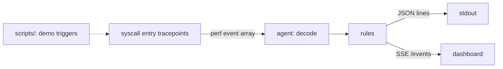

# Architecture

## Parts

- **Probe** (`ebpf/process_monitor.c`): one program on the raw `sys_enter` tracepoint. It runs for every system call, returns at once for all but six (`execve`, `execveat`, `connect`, `ptrace`, `memfd_create`, `mmap`), and for those fills one fixed-size `event_t` and writes it to a perf event array. It reports every call to the first five and leaves the judging to the agent. The single kernel-side filter is on `mmap`: an executable mapping is reported if it is also writable or is anonymous, and a read-only executable mapping of a file (every program and library load) is not.
- **Agent** (`agent/`):
  - `main_linux.go` loads the object, attaches the program and reads the perf buffer.
  - `event.go` decodes a sample into a `RuntimeEvent`. The Go struct mirrors `event_t` byte for byte; a static assertion in the C file and a size test in Go keep the two from drifting.
  - `rules.go` holds the rules as pure functions, each deciding from a single event. For exec events the agent first makes the path absolute and cleans it (`resolveExecPath`).
  - `containers.go` guesses a container ID from `/proc/<pid>/cgroup` and reads the agent's own pod name from the environment.
  - `server.go` fans alerts out to Server-Sent Events subscribers, and refuses to serve them beyond loopback without a bearer token.
- **Dashboard** (`dashboard/`): one React page that subscribes to `/events`. It keeps the newest 200 alerts in memory and has no backend of its own.
- **Chart** (`deploy/helm/`): a template that has not been installed anywhere.

## Flow

## Choices and their cost

- **No CO-RE, no `vmlinux.h`.** The probe carries the register offsets and syscall numbers for x86-64 and arm64 itself, so it builds with only clang and the libbpf headers. The cost is that it supports just those two architectures and cannot read kernel structures, which is why there is no parent PID and no socket protocol.
- **One raw tracepoint, not six syscall tracepoints.** The first version attached a program to each `syscalls:sys_enter_*` tracepoint. On the CI runner's 7.0 kernel, events for the three calls that take a string argument (`execve`, `execveat`, `memfd_create`) arrived only from CPU 0; the cause was not tracked down. The raw tracepoint delivers from every CPU. The cost is a program that runs on every system call, even though it returns after one comparison for nearly all of them.
- **Perf event array, not a ring buffer.** It works on older kernels. It is per-CPU, so events from different CPUs can arrive out of order, and a slow reader loses events.
- **Rules in user space.** They are easy to read and test, and every event crosses into user space to be judged, which is the expensive way to do it. Nothing here has been measured.
- **One event, one decision.** No state is kept between events, so nothing like "a shell was started and then connected out" can be expressed.
- **Paths are matched in user space.** The probe hands over the string the caller passed to `execve`, and the agent normalises it. That is cheap and testable, and it is evadable with links or a fast exit; resolving the file in the kernel at `sched_process_exec` would close that and is the obvious next step.
