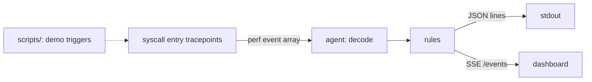

# Architecture

## Parts

- **Probe** (`ebpf/process_monitor.c`): five programs, one per syscall-entry tracepoint (`execve`, `connect`, `ptrace`, `memfd_create`, `mmap`). Each fills one fixed-size `event_t` and writes it to a perf event array. Filtering done in the kernel is deliberately small: `connect` reports IPv4 only, `ptrace` only attach, seize and poke requests, and `mmap` only mappings that are writable and executable at once.
- **Agent** (`agent/`):
  - `main_linux.go` loads the object, attaches each program to its tracepoint and reads the perf buffer.
  - `event.go` decodes a sample into a `RuntimeEvent`. The Go struct mirrors `event_t` byte for byte; a static assertion in the C file and a size test in Go keep the two from drifting.
  - `rules.go` holds four pure functions, each deciding from a single event.
  - `containers.go` guesses a container ID from `/proc/<pid>/cgroup` and reads the agent's own pod name from the environment.
  - `server.go` fans alerts out to Server-Sent Events subscribers.
- **Dashboard** (`dashboard/`): one React page that subscribes to `/events`. It keeps the newest 200 alerts in memory and has no backend of its own.
- **Chart** (`deploy/helm/`): a template that has not been installed anywhere.

## Flow

## Choices and their cost

- **No CO-RE, no `vmlinux.h`.** The probe declares the tracepoint context itself, so it builds with only clang and the libbpf headers. The cost is that it cannot read kernel structures, which is why there is no parent PID and no socket protocol.
- **Perf event array, not a ring buffer.** It works on older kernels. It is per-CPU, so events from different CPUs can arrive out of order, and a slow reader loses events.
- **Rules in user space.** They are easy to read and test, and every event crosses into user space to be judged, which is the expensive way to do it. Nothing here has been measured.
- **One event, one decision.** No state is kept between events, so nothing like "a shell was started and then connected out" can be expressed.
